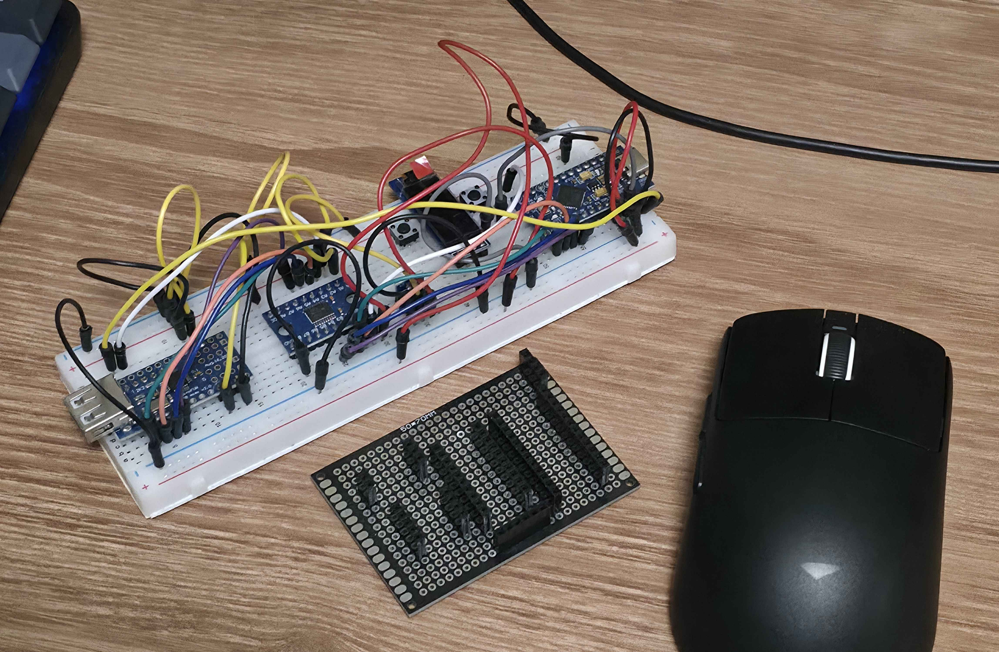

# Development-HIDBypassUSBHost

## Preview



---

Arduino Leonardo와 USB Host Shield로 USB 마우스 입력을 받아 PC에 HID 마우스로 전달하는 프로젝트입니다. Windows에서 제공되는 로컬 설정 페이지를 열면 WebHID로 감도, 이동 방향, 버튼 매핑을 변경하고 Leonardo의 EEPROM에 프로필을 저장할 수 있습니다.

## 준비물

- Arduino Leonardo 또는 프로젝트의 `leonardo_proxy` 보드 설정과 호환되는 ATmega32U4 보드
- USB Host Shield 2.0 호환 하드웨어, USB HID 마우스 또는 호환 수신기, PC 연결용 USB 데이터 케이블
- 펌웨어 빌드용 PlatformIO Core 또는 VS Code의 PlatformIO IDE 확장
- 내장 웹 서버 실행용 Windows x64 환경과 WebHID를 지원하는 Chrome 또는 Edge

마우스나 수신기는 USB Host Shield의 USB 포트에 연결하고, Leonardo의 USB 포트는 PC에 연결합니다.

```text
USB 마우스 또는 수신기 → USB Host Shield → Leonardo → PC
브라우저 설정 페이지 ↔ Leonardo (WebHID)
```

입력은 HID Boot Mouse 형식을 사용합니다. 펌웨어는 버튼과 X/Y 이동을 읽고, 입력 리포트에 네 번째 바이트가 있으면 휠 이동으로 처리합니다. 사용할 수 있는 버튼과 휠 기능은 마우스나 수신기가 이 형식으로 보내는 입력에 따라 달라집니다.

## 펌웨어 빌드 및 업로드

저장소 루트에서 실행합니다. VS Code를 사용하는 경우 `firmware/`를 PlatformIO 프로젝트로 열고 PlatformIO 터미널에서 실행할 수 있습니다.

```powershell
pio run -d firmware -e leonardo
pio run -d firmware -e leonardo -t upload
```

`leonardo` 환경은 Arduino 프레임워크와 `felis/USB-Host-Shield-20` 라이브러리를 사용합니다. 빌드 산출물은 `firmware/.pio/build/leonardo/firmware.hex`에 생성됩니다. `firmware/`에서 명령을 실행하는 경우 `-d firmware`를 생략합니다.

현재 빌드는 `CDC_DISABLED`를 사용합니다. 실행 중인 펌웨어에서 시리얼 포트가 나타나지 않아 자동 업로드가 실패하면, 업로드 중 Leonardo의 리셋 버튼을 눌러 부트로더 포트가 나타나는지 확인하세요.

## 웹 설정 페이지 실행

1. 저장소 루트에서 아래 명령을 실행하거나 탐색기에서 `web/run-caddy.bat`를 엽니다.

   ```powershell
   .\web\run-caddy.bat
   ```

2. Chrome 또는 Edge에서 [http://localhost:9090](http://localhost:9090)을 엽니다.
3. **장치 연결**을 눌러 브라우저의 장치 선택 창에서 Leonardo를 선택합니다. 연결되면 브라우저가 장치의 현재 설정을 불러옵니다.
4. 감도, 축 반전, 휠 방향, 버튼 매핑을 변경합니다. 변경 사항은 즉시 적용되며, 전원을 껐다 켜도 유지하려면 **EEPROM 저장**을 누릅니다.

서버를 종료하려면 실행 창에서 `Ctrl+C`를 누릅니다.

## 설정과 프로필

| 기능 | 동작 |
| --- | --- |
| 커서 감도 | X/Y 이동을 25~400% 범위에서 조절합니다. 기본값은 100%입니다. |
| 방향 반전 | X축, Y축, 휠을 각각 반전할 수 있습니다. 기본값은 모두 꺼짐입니다. |
| 버튼 리맵핑 | 입력 버튼 1~8을 원하는 출력 버튼으로 매핑하거나 **사용 안 함**으로 설정합니다. 기본값은 같은 번호의 버튼입니다. |
| 다시 읽기 | 장치에 현재 적용된 설정과 프로필 목록을 다시 불러옵니다. |
| 기본값 복원 | 현재 프로필에 기본값을 즉시 적용합니다. 재부팅 후에도 유지하려면 **EEPROM 저장**을 누릅니다. |
| EEPROM 저장 | 현재 프로필의 설정과 재부팅 시 활성화할 프로필을 저장합니다. |

프로필은 최대 4개를 사용할 수 있습니다. **현재 프로필 복제**는 현재 적용된 설정을 빈 슬롯에 복제하고 새 프로필을 활성화해 즉시 저장합니다. **삭제**는 활성 프로필을 제거하고 남은 슬롯 중 번호가 가장 낮은 프로필로 전환해 저장합니다. 프로필은 최소 1개를 유지합니다. 드롭다운에서 프로필을 전환하면 즉시 적용되며, 다음 부팅에서도 해당 프로필을 사용하려면 **EEPROM 저장**을 누릅니다.

## 파일 구성

| 경로 | 역할 |
| --- | --- |
| `Development-HIDBypassUSBHost.code-workspace` | 저장소 루트를 여는 VS Code 워크스페이스 |
| `firmware/platformio.ini`, `firmware/boards/leonardo_proxy.json` | PlatformIO 환경과 커스텀 보드 정의 |
| `firmware/src/main.cpp` | 설정 로드, USB 초기화, 주 처리 루프 |
| `firmware/src/MouseBridge.*`, `firmware/src/InputProcessor.*`, `firmware/src/OutputMouse.*` | USB 마우스 입력 읽기, 입력 변환, PC로 HID 마우스 리포트 전송 |
| `firmware/src/MouseConfig.h`, `firmware/src/ConfigManager.*` | 기본값과 유효 범위, 프로필 관리, EEPROM 저장 및 이전 설정 읽기 |
| `firmware/src/ConfigHID.*`, `web/hid.js` | 설정 전용 HID 인터페이스와 브라우저 측 통신 |
| `firmware/include/`, `firmware/lib/`, `firmware/test/` | 프로젝트 헤더, 라이브러리, 테스트를 위한 PlatformIO 템플릿 디렉터리 |
| `web/index.html`, `web/app.js`, `web/style.css` | 마우스 설정 화면 |
| `web/Caddyfile`, `web/run-caddy.bat`, `web/caddy_windows_amd64.exe` | `localhost:9090`에서 설정 화면을 제공하는 Windows 실행 파일과 설정 |
| `web/for_test.html` | 장치 연결, 설정 읽기, X축 반전, EEPROM 저장, 기본값 적용을 확인하는 테스트 페이지 |

## 동작 확인

메인 설정 화면에서 장치를 연결하고 마우스 이동, 버튼, 휠을 확인합니다. X축 반전이나 감도를 바꿔 즉시 적용되는지 확인한 뒤 **EEPROM 저장**을 누릅니다. Leonardo를 다시 연결하고 웹 페이지에서 설정을 불러와 저장한 값과 활성 프로필이 복원되는지 확인합니다.

`web/for_test.html`은 현재 `./web/hid.js`를 불러옵니다. Caddy의 문서 루트는 `web/`이므로 이 페이지가 실제 `hid.js`를 찾으려면 참조 경로를 `./hid.js`로 바꿔야 합니다. 현재 구성에서는 메인 설정 화면에서 동작을 확인할 수 있습니다.
